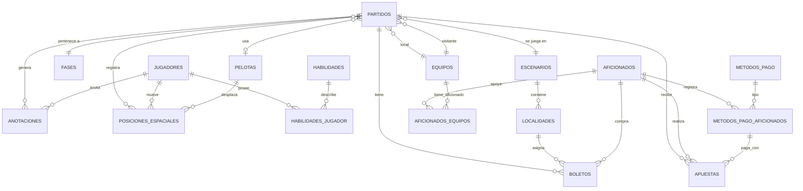

# Diagrama Entidad-Relación y Diccionario de Datos (Participante B)

## 1. Diagrama Entidad-Relación (Mermaid DER)

## 2. Definición de Tablas Principales (MySQL snake_case)

### `partidos`
- `id`: INT AUTO_INCREMENT PRIMARY KEY
- `fecha_hora`: DATETIME NOT NULL
- `estado`: ENUM('PROGRAMADO', 'EN_CURSO', 'FINALIZADO', 'CANCELADO') DEFAULT 'PROGRAMADO'
- `marcador_local`: INT DEFAULT 0
- `marcador_visitante`: INT DEFAULT 0
- `cuota_local`: DECIMAL(5,2) DEFAULT 1.00
- `cuota_empate`: DECIMAL(5,2) DEFAULT 1.00
- `cuota_visitante`: DECIMAL(5,2) DEFAULT 1.00
- `fase_id`: INT NOT NULL (FK fases)
- `escenario_id`: INT NULL (FK escenarios)
- `equipo_local_id`: INT NOT NULL (FK equipos)
- `equipo_visitante_id`: INT NOT NULL (FK equipos)
- `pelota_id`: INT NULL (FK pelotas)

### `anotaciones`
- `id`: INT AUTO_INCREMENT PRIMARY KEY
- `partido_id`: INT NOT NULL (FK partidos ON DELETE CASCADE)
- `jugador_id`: INT NOT NULL (FK jugadores)
- `minuto`: INT NOT NULL
- `tipo`: VARCHAR(50) DEFAULT 'GOL'
- `descripcion`: VARCHAR(255) NULL

### `posiciones_espaciales`
- `id`: INT AUTO_INCREMENT PRIMARY KEY
- `partido_id`: INT NOT NULL (FK partidos ON DELETE CASCADE)
- `jugador_id`: INT NULL (FK jugadores)
- `pelota_id`: INT NULL (FK pelotas)
- `posicion_x`: DECIMAL(5,4) NOT NULL (0.0000 a 1.0000)
- `posicion_y`: DECIMAL(5,4) NOT NULL (0.0000 a 1.0000)
- `timestamp`: DATETIME NOT NULL

### `apuestas`
- `id`: INT AUTO_INCREMENT PRIMARY KEY
- `aficionado_id`: INT NOT NULL (FK aficionados)
- `partido_id`: INT NOT NULL (FK partidos)
- `metodo_pago_aficionado_id`: INT NOT NULL (FK metodos_pago_aficionados)
- `seleccion`: ENUM('GANA_LOCAL', 'EMPATE', 'GANA_VISITANTE') NOT NULL
- `monto`: DECIMAL(10,2) NOT NULL
- `cuota`: DECIMAL(5,2) NOT NULL (congelada al apostar)
- `estado`: ENUM('REGISTRADA', 'GANADA', 'PERDIDA', 'ANULADA', 'CANCELADA') DEFAULT 'REGISTRADA'
- `valor_pagado`: DECIMAL(10,2) DEFAULT 0.00
- `fecha_apuesta`: DATETIME NOT NULL
- `fecha_liquidacion`: DATETIME NULL
