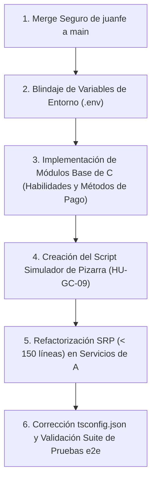

# Propuesta Técnica: Integración y Completitud del Backend (Participantes A, B y C)

## 1. Resumen Ejecutivo
Se realizó una auditoría y revisión exhaustiva de los cambios realizados por el compañero de equipo (**Juan Felipe / Participante A**) alojados en la rama remota `origin/juanfe` (commit `6f9d515: nucleo deportivo + estructura del torneo implementado`).

El objetivo de esta propuesta es unificar formalmente el trabajo de ambos participantes en la rama `main`, completar los módulos pendientes del sistema (particularmente los asignados al Participante C y el simulador de pizarra deportiva) y ajustar el código a los estándares de gobernanza técnica (modularidad, límite estricto de 150 líneas por archivo y pruebas automatizadas) garantizando una **regresión cero** sobre los módulos existentes de Persona B.

---

## 2. Diagnóstico de los Cambios del Compañero (Participante A)

### 2.1 Aspectos Positivos y Aciertos Técnicos
1. **Implementación Funcional Completa de sus 12 Entidades:**
   - `Deportes` (HU-GD-01: jerarquía/subdeportes y soft delete).
   - `Equipos` (HU-GD-02: género y estado).
   - `Equipos-Deportes` (HU-GD-03: asignación N:M).
   - `Jugadores` (HU-GD-04: documento único y soft delete).
   - `Equipos-Jugadores` (HU-GD-05: historial de traspasos y periodos de vigencia).
   - `Perfil de Jugador` (HU-GD-08: estadísticas, habilidades y trayectoria).
   - `Torneos` (HU-GC-01: estados de torneo y cierre de inscripciones).
   - `Inscripciones` (HU-GC-08a: validación de fechas y cupos).
   - `Fases` (HU-GC-03: orden de fases y tipos GRUPO/FINAL).
   - `Grupos` (HU-GC-04: grupos independientes y tabla intermedia `grupo_equipo`).
   - `Fases Finales` (HU-GC-05: estructura de llaves).
   - `Escenarios` y `Escenarios-Torneos`: jerarquía de escenarios y asignación a torneos.
2. **Compatibilidad con Persona B:**
   - En lugar de eliminar los stubs, modificó `backend/src/features/stubs/entities/*.entity.ts` para re-exportar las entidades reales (`export * from '../../...'`), evitando romper los imports de partidos, anotaciones y boletos de B.
3. **DDL Aditivo y Limpio:**
   - `docs/database/extension-participante-a.sql` contiene sentencias `ALTER TABLE` que no destruyen datos previos sembrados.
4. **Compilación Exitosa:**
   - `nest build` compila limpiamente sin errores de tipado TypeScript.

---

### 2.2 Puntos Críticos y Brechas a Corregir

1. **Rama Desconectada:** Los cambios están en `origin/juanfe` y aún no se han fusionado con `main`.
2. **Credenciales en `app.module.ts`:** Se reemplazaron los valores por defecto de la BD (`mostro` / `210910624Dj`) por los locales de Juanfe. Debe quedar blindado para que tome `.env` prioritariamente sin romper entornos locales.
3. **Módulos Faltantes (Participante C):**
   - **`Habilidades` (HU-GD-06):** El catálogo base de habilidades aún vive como stub (`features/stubs/entities/habilidad.entity.ts`). Debe implementarse como módulo propio (`features/habilidades/`).
   - **`Métodos de Pago` (HU-GC-10):** El catálogo de métodos de pago vive como stub. Debe implementarse como módulo propio (`features/metodos-pago/`) para alimentar el catálogo que consume `metodos-pago-aficionado`.
   - **`Simulador de Pizarra` (HU-GC-09):** Falta el script simulador de generación periódica de posiciones espaciales de jugadores y pelota para alimentar en vivo los partidos.
4. **Gobernanza de Código (Límite 150 Líneas):**
   - 7 servicios de A superan las 150 líneas de código (`torneos.service.ts` con 278, `escenarios.service.ts` con 235, `jugadores.service.ts` con 232, `deportes.service.ts` con 220, `grupos.service.ts` con 219, `equipos-jugadores.service.ts` con 207, `inscripciones.service.ts` con 199).
5. **Configuración de Tests Jest / TypeScript:**
   - `npm test` lanza un error `TS5011` debido a la resolución de `rootDir` en `tsconfig.json`.

---

## 3. Plan de Acción y Ejecución Modular

### Fase 1: Merge Seguro y Preservación de Entorno
- Fusionar `origin/juanfe` en `main` sin conflictos.
- Asegurar que `backend/src/app.module.ts` lea las variables de entorno de `ConfigService` con fallback estándar.

### Fase 2: Implementación de Catálogos de C (Habilidades y Métodos Pago)
- Crear `features/habilidades/` con su DTO, entidad, mapper, service (< 150 líneas), controller y módulo Nest.
- Crear `features/metodos-pago/` con su DTO, entidad, mapper, service (< 150 líneas), controller y módulo Nest.
- Actualizar los stubs para re-exportar estas entidades, completando el 100% de entidades del sistema.

### Fase 3: Script Simulador de Pizarra Deportiva (HU-GC-09)
- Crear `backend/scripts/simulador-posiciones.js` (o `.ts` ejecutable):
  * Consulta el partido activo y sus jugadores vinculados.
  * Genera coordenadas dinámicas normalizadas (0 a 100 en X e Y) para jugadores y pelota.
  * Envía ráfagas al endpoint `POST /api/v1/partidos/{id}/posiciones/lote` con intervalo configurable.

### Fase 4: Modularización y Cumplimiento de Límites (< 150 Líneas)
- Fragmentar los servicios extensos de A extrayendo la lógica de validación a validators auxiliares (`*.validator.ts` o helpers dedicados), manteniendo cada archivo bajo 150 líneas y 100% compatible.

### Fase 5: Pruebas y Verificación Integral
- Corregir `rootDir: "./src"` en `tsconfig.json`.
- Ejecutar suite de pruebas unitarias (`npm test`) y pruebas e2e integradas.
- Actualizar y sincronizar con GitHub en la rama `main` a nombre de David Solorza.

---

## 4. Criterios de Aceptación y Validación
- [ ] Cero regresiones en los endpoints de Persona B (partidos, apuestas, boletos, anotaciones, pizarra).
- [ ] Todos los módulos de A compilando y expuestos bajo `/api/v1/...`.
- [ ] Módulos de C creados y funcionando.
- [ ] Ningún archivo de código supera las 150 líneas.
- [ ] `npm run build` y `npm test` finalizan con código de salida 0.
- [ ] Repositorio en GitHub sincronizado limpiamente.
