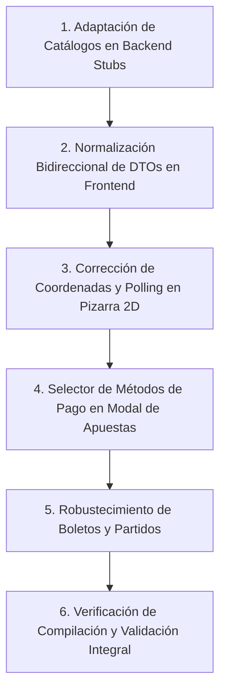

# Propuesta Técnica: Pulido y Perfeccionamiento del Frontend (Participante B)

## 1. Resumen Ejecutivo
A solicitud del usuario, se realizó una auditoría funcional y técnica completa de los 7 módulos del **Participante B** en el frontend (`mostro-sport-frontend`):
1. **Gestión de Partidos** (`HU-GC-06` / `HU-GC-07`).
2. **Apuestas Deportivas** (`HU-GC-11`).
3. **Boletería y Localidades** (Venta de boletos).
4. **Pizarra Táctica en Vivo** (`HU-GC-09`).
5. **Desarrollo del Torneo** (`HU-GC-08b`).
6. **Perfil del Aficionado y Métodos de Pago** (`HU-GC-10`).
7. **Habilidades de Jugadores** (`HU-GD-07`).

El objetivo es corregir las inconsistencias de contrato (snake_case vs camelCase), resolver la lógica de coordenadas de la pizarra, conectar los catálogos con los datos reales del backend y mejorar sustancialmente la experiencia de usuario (UX/UI), estados de carga, manejo de errores y validaciones en pantalla, manteniendo la regla estricta de **menos de 150 líneas por archivo**.

---

## 2. Diagnóstico de Inconsistencias y "Lógicas Malucas" Detectadas

### 2.1 Incompatibilidad de DTOs (snake_case vs camelCase)
- **Creación de Partidos:** El modal enviaba `{ id_torneo, id_escenario, id_equipo_local, id_equipo_visitante, fecha_hora }`, pero el backend NestJS con `ValidationPipe` exige `{ torneoId, escenarioId, equipoLocalId, equipoVisitanteId, fechaHora }`. Esto provocaba error `400 Bad Request`.
- **Emisión de Boletos:** El frontend enviaba `{ id_partido, id_localidad }`, mientras que el backend espera `{ partidoId, localidadId }`.
- **Registro de Apuestas:** El frontend enviaba `{ id_aficionado, id_partido }` omitiendo `metodoAficionadoId` (obligatorio por clave foránea en BD). Además, el modal no permitía al aficionado seleccionar con cuál de sus métodos de pago registrados deseaba apostar.

### 2.2 Desconexión de Catálogos (Stubs)
- `stubsService.ts` en el frontend consultaba rutas como `/stubs/torneos`, `/stubs/equipos`, etc. En el backend, `stubs.controller.ts` solo exponía `/stubs/seed` y `/stubs/health`.
- Como resultado, los selectores de torneos, equipos, escenarios y habilidades no cargaban datos reales o arrojaban error 404.

### 2.3 Error Crítico en la Pizarra Táctica 2D (HU-GC-09)
- En `PizarraCampoPage.tsx`, al recibir las posiciones del backend, se multiplicaba `pos.x * 100` y `pos.y * 100`. Como el simulador y backend ya envían coordenadas en porcentaje (ej: 25.5, 60.0), el resultado era `2550%` y `6000%`, expulsando a los jugadores y el balón fuera del campo visual.
- La simulación local de jugada enviaba valores normalizados decimales (0 a 1) en lugar de la escala porcentual (0 a 100).

### 2.4 Experiencia de Usuario y Feedback en Pantalla
- Las acciones de creación y eliminación usaban alertas nativas o fallaban en silencio sin mostrar mensajes de error descriptivos del backend.
- Faltaban estados de "Sin métodos de pago disponibles" con redirección rápida al perfil en el modal de apuestas.

---

## 3. Plan de Pulido y Corrección

### Fase 1: Habilitación de Catálogos en Backend (`stubs.controller.ts`)
- Implementar en `stubs.controller.ts` los endpoints GET (`torneos`, `escenarios`, `equipos`, `jugadores`, `pelotas`, `habilidades`, `metodos-pago`, `fases/:torneoId`).
- Cada endpoint devolverá objetos con formato compatible dual: tanto claves estándar (`id`) como de stubs (`id_torneo`, `id_equipo`, etc.) para máxima resiliencia.

### Fase 2: Normalización de DTOs en el Frontend
- **Partidos (`partidosService.ts`):** Transformador que asegura el envío de campos tanto en camelCase como snake_case.
- **Boletos (`boletosService.ts`):** Asegurar el mapeo de `partidoId` y `localidadId`.
- **Apuestas (`apuestasService.ts` & `NuevaApuestaModal.tsx`):**
  * Cargar los métodos de pago del aficionado.
  * Añadir selector de método de pago en el formulario de apuesta.
  * Enviar `metodoAficionadoId`, `aficionadoId`, `partidoId`, `monto`.

### Fase 3: Corrección y Suavizado de la Pizarra Táctica (HU-GC-09)
- Normalizar dinámicamente las coordenadas en `PizarraCampoPage.tsx`:
  `const x = pos.x <= 1 ? pos.x * 100 : pos.x;`
- Sincronizar el simulador interactivo para que envíe coordenadas dentro del campo (0 a 100).
- Mostrar nombres de los equipos reales en la marquesina superior en lugar de marcadores estáticos.

### Fase 4: Manejo de Errores y UI Refinada
- Agregar mensajes de error legibles en los modales cuando el backend responda con `400` o `409`.
- Mantener todos los archivos estrictamente bajo **150 líneas**.

---

## 4. Criterios de Aceptación
- [ ] Creación de partidos funcionando y visible en la lista.
- [ ] Emisión de boletos asociada al escenario y partido funcionando.
- [ ] Creación de apuestas con selección de método de pago y cuota congelada.
- [ ] Pizarra táctica visualizando jugadores y pelota dentro del campo en tiempo real.
- [ ] Catálogos de torneos, equipos, jugadores y habilidades cargando datos dinámicos.
- [ ] `npm run build` en el frontend finaliza con 0 errores TypeScript.
- [ ] Todos los archivos cumplen la regla de menos de 150 líneas.
